# مراجعة مناطق الآيات على صور الصفحات ١–٦٠٤

تاريخ المراجعة: ٢٠٢٦-١١-٠٥

لم يُعدَّل أي ملف بيانات في هذه المراجعة.

الملف المراجَع:

`mushaf_app/app/src/main/assets/data/ayah_regions.json`

وهو مطابق تماماً لما يولّده السكربت الحالي:

`build_ayah_regions.py`

(أُعيد توليده في مجلد مؤقت وقورن سجلاً سجلاً: ٠ فروق من ٦٢٣٦). أي أن كل ما يلي صادر عن منطق التوليد وبيانات النهايات، لا عن تعديل يدوي.

---

## الخلاصة

**إحداثيات الآيات سليمة.** لم أجد آية تنتهي عند غير دائرتها، ولا فجوة نصية خارج الآيات، ولا تداخلاً، ولا رأس سورة أو بسملة محسوبة داخل آية.

| الفحص | النتيجة |
|---|---|
| عدد السجلات وتسلسلها (١١٤ سورة بعدد آياتها) | ٦٢٣٦ سجلاً متسلسلاً بلا تكرار ولا نقص |
| نهاية كل آية على دائرة رقمها المطبوعة | ٦٢٣٦ / ٦٢٣٦، أبعد انحراف ٣٫٣ بكسل (المتوسط ٢٫٦) |
| الرقم المطبوع داخل الدائرة = رقم الآية | ٦٢٣٦ / ٦٢٣٦ (آلياً ثم بصرياً لكل حالة مشكوك فيها) |
| دوائر مطبوعة بلا آية تنتهي عندها | ٠ |
| ترتيب الدوائر في القراءة (سطراً سطراً من اليمين) = ترتيب الآيات | سليم في كل الصفحات |
| نص قرآني خارج كل الآيات (فجوة) | ٠ |
| تداخل بين منطقتي آيتين | ٠ |
| دائرة الآية داخل منطقتها كاملة، ولا تغطيها آية أخرى | سليم في كل الآيات |
| إطارات أسماء السور في الصور | ١١٢ إطاراً، كلها مطابقة لبدايات السور في البيانات |
| البسملات | ١١١ بسملة (كل السور عدا التوبة)، لا تغطيها أي آية |
| الآية الأولى من كل سورة تبدأ بعد الإطار والبسملة مباشرة | سليم في كل السور |
| نص بعد آخر دائرة في الصفحة (آية تعبر إلى الصفحة التالية) | ٠ |
| أشرطة التظليل على أسطر النص الفعلية | كلها، بلا شريط فوق سطر فارغ |

ما يحتاج قرارك ثلاث ملاحظات، مرتبة بالأهمية:

1. ترقيم الصفحات في صورنا يختلف عن ترقيم المصحف المعروف في ٣٦ صفحة (٥٦ آية). البيانات تتبع الصور بدقة؛ الاختلاف في الصور نفسها.
2. اللمس في الفراغ بين سطرين يختار آية بعيدة في ٤٣٪ من الحالات. هذا خلل في كود الاختيار، لا في الإحداثيات.
3. في ١٧ سطراً قصيراً متوسَّطاً (خواتيم سور) يمتد التظليل فوق ورق فارغ على يمين النص. تجميلي.

---

## طريقة الفحص

كل خصائص الصورة استُخرجت من البكسلات وحدها، دون الاستعانة ببيانات التطبيق:

- **دوائر أرقام الآيات:** الحشوة الخضراء الفاتحة داخل كل دائرة مطبوعة؛ وفي الصفحتين ١ و٢ (دوائرهما بيضاء) الأرقام الحمراء.
- **إطارات السور:** الأشرطة الملونة العريضة بعرض الصفحة.
- **حبر النص:** البكسلات الداكنة غير الملونة.
- **شبكة الأسطر الـ١٥:** من مواضع الدوائر المكتشفة في كل صفحة (المسافة بين السطور ١١٦–١١٩ بكسل).
- **البسملة:** السطر الذي يلي الإطار وفيه نص بلا دائرة.

ثم قورنت البيانات بها، وبترقيم صفحات

quran.com

المحفوظ في المستودع. وطابقته الواجهة الحية للموقع في الصفحات ١٢٠ و١٤٥ و٥٨٦ و٥٩٥ و٥٩٨ التي جرّبتها، بأكثر من نوع مصحف.

**التحقق من الأرقام داخل الدوائر:** قُورن قناع الرقم الأحمر في كل دائرة بمتوسط كل الدوائر الأخرى التي تحمل الرقم نفسه والرقمين المجاورين. اشتبه المصنّف في ٣٠ دائرة بفروق ضئيلة، وكلها صحيحة بالفحص البصري. والـ٧١ دائرة التي لا يمكن فحصها آلياً (البقرة ٢٢٨–٢٨٦ لأن كل رقم منها لا يتكرر، والصفحتان ١ و٢) فُحصت بصرياً كلها.

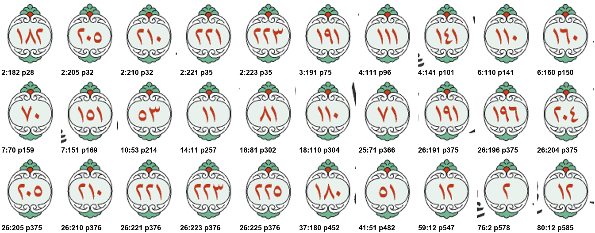

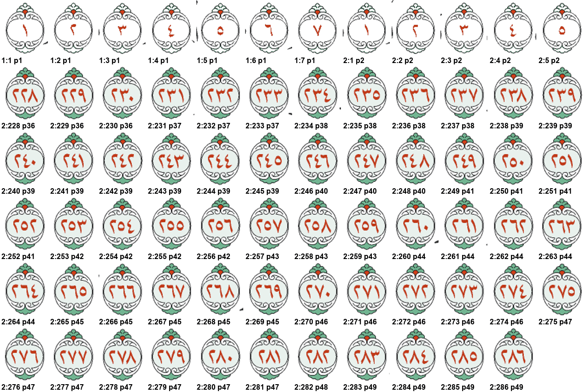

**التحقق من صلاحية الفحوص نفسها:** حقنتُ سبعة أخطاء مصطنعة في نسخة من البيانات (تبديل نهايتين، إزاحة نهاية عن دائرتها، تظليل فوق البسملة، تظليل فوق إطار سورة، تقصير منطقة لتظهر فجوة، توسيع منطقة لتتداخل، نقل آية إلى صفحة أخرى). التقطها السكربت كلها.

**الفحص البصري:** رُسمت المناطق والنهايات والدوائر المكتشفة فوق الصفحات: ١، ٢، ٣، ٥٠، ٧٧، ١٠٦، ١٢٠–١٢١، ١٤٤–١٤٥، ١٨٧، ٢٥٥–٢٥٦، ٥٢٨، ٥٤٥، ٥٨٥–٥٨٦، ٥٩٥، ٦٠٢–٦٠٤. أغلبها صفحات تبدأ فيها سور أو تنتهي. كلها سليمة.

دليل الرسوم: كل لون منطقة آية، والصليب الأزرق نهايتها المخزنة، والبيضاوي الأخضر الدائرة المكتشفة في الصورة، والإطار الأحمر رأس السورة، والبرتقالي البسملة، والوردي العريض موضع ملاحظة.

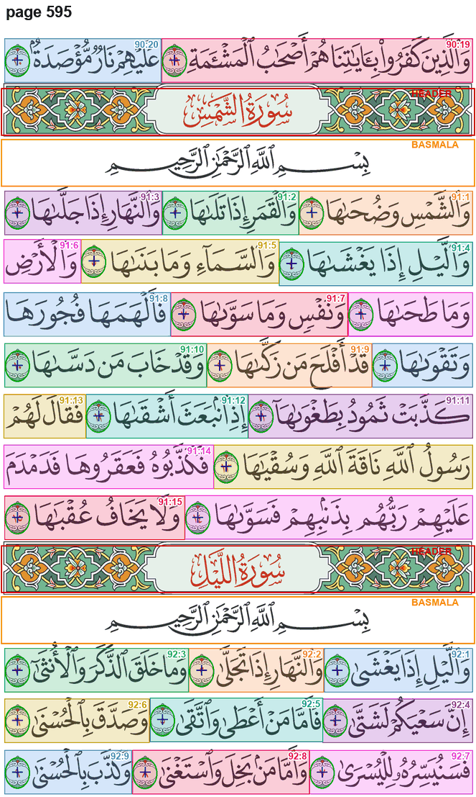

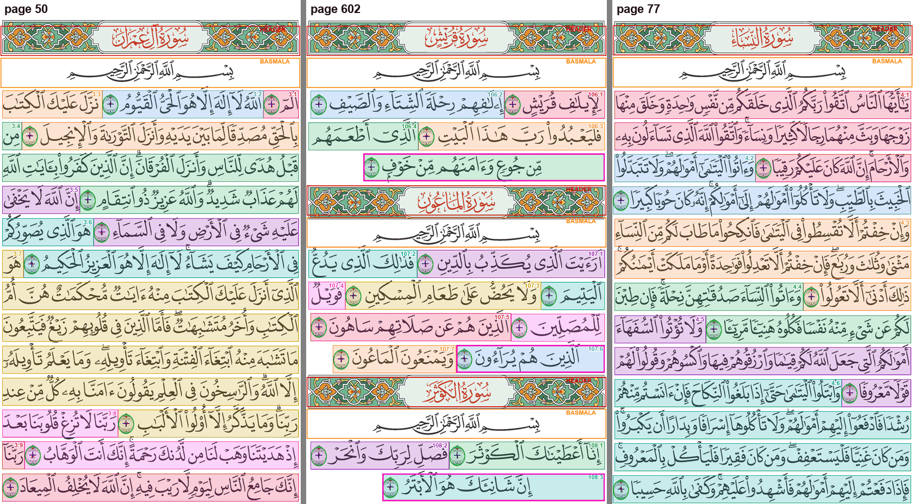

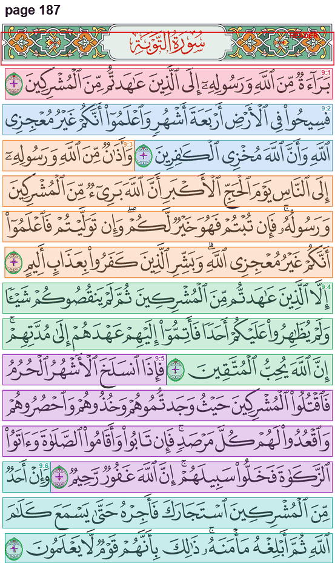

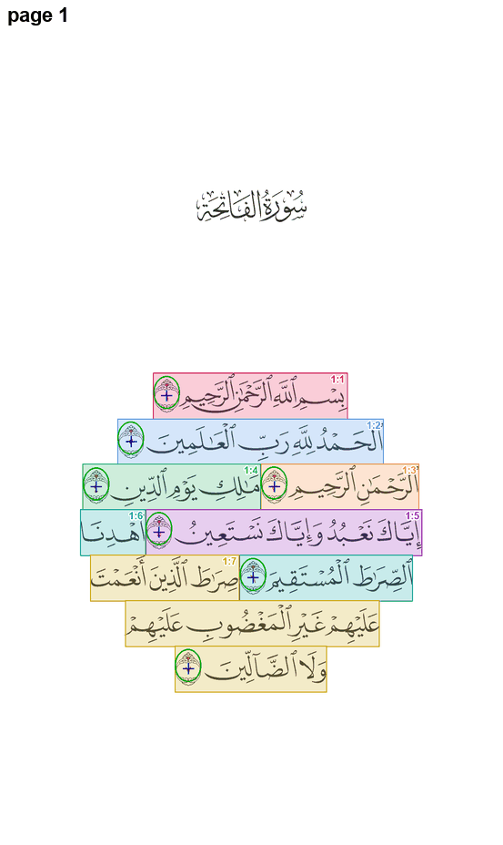

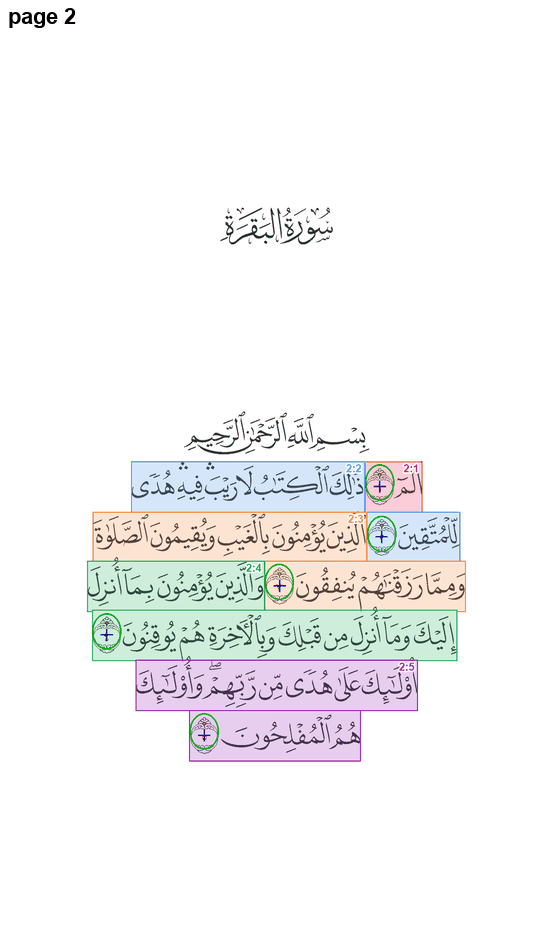

---

## الملاحظة ١: ترقيم صفحات الصور يخالف المصحف المعروف في ٣٦ صفحة

**ما وجدته:** في ٣٦ صفحة تختلف الآيات الموجودة في صورة الصفحة عن الصفحة نفسها في

quran.com

(٥٦ آية في صفحة مجاورة). والواجهة الحية للموقع تعطي الترقيم المحفوظ نفسه في كل صفحة جرّبتها. مثال: في صورنا تبدأ الصفحة ٥٨٦ بآيتي عبس ٤١–٤٢ ثم سورة التكوير، بينما تبدأ في ذلك الترقيم بالتكوير.

**لماذا ليست خطأً في البيانات:** الدوائر المطبوعة في كل صورة بعدد سجلات صفحتها تماماً، وأرقامها تطابق آياتها. فالبيانات تصف الصور كما هي؛ الصور نفسها من طبعة يختلف توزيع أسطرها في هذه المواضع.

**الأثر:** من يقارن التطبيق بمصحف ورقي من الطبعة المعروفة سيجد هذه الآيات في الصفحة المجاورة. أما داخل التطبيق فكل شيء متسق: الفهرس والبحث والعلامات والختمات والتلاوة تقرأ الصفحة من البيانات نفسها.

**تقسيم الأجزاء لا يتأثر:** الجزء ٧ يبدأ بالمائدة ٨٢، وهي في الصفحة ١٢١ في الترقيمين، والجزء ١١ لا يقع في أي صفحة مختلفة. ولم ألمس منطق الصفحتين ١٢١ و٢٠١.

| الصفحة | الصورة: أول آية | الصورة: آخر آية | المعروف: أول آية | المعروف: آخر آية |
|---:|---|---|---|---|
| 120 | 5:71 | **5:77** | 5:71 | 5:76 |
| 121 | **5:78** | **5:83** | 5:77 | 5:82 |
| 122 | **5:84** | **5:90** | 5:83 | 5:89 |
| 123 | **5:91** | 5:95 | 5:90 | 5:95 |
| 144 | 6:125 | **6:130** | 6:125 | 6:131 |
| 145 | **6:131** | 6:137 | 6:132 | 6:137 |
| 531 | 54:50 | **55:18** | 54:50 | 55:16 |
| 532 | **55:19** | **55:41** | 55:17 | 55:40 |
| 533 | **55:42** | **55:69** | 55:41 | 55:67 |
| 534 | **55:70** | 56:16 | 55:68 | 56:16 |
| 564 | 67:27 | **68:16** | 67:27 | 68:15 |
| 565 | **68:17** | 68:42 | 68:16 | 68:42 |
| 567 | 69:9 | **69:35** | 69:9 | 69:34 |
| 568 | **69:36** | 70:10 | 69:35 | 70:10 |
| 569 | 70:11 | **70:40** | 70:11 | 70:39 |
| 570 | **70:41** | 71:10 | 70:40 | 71:10 |
| 575 | 73:20 | **74:18** | 73:20 | 74:17 |
| 576 | **74:19** | 74:47 | 74:18 | 74:47 |
| 583 | 78:31 | **79:16** | 78:31 | 79:15 |
| 584 | **79:17** | 79:46 | 79:16 | 79:46 |
| 585 | 80:1 | **80:40** | 80:1 | 80:42 |
| 586 | **80:41** | 81:29 | 81:1 | 81:29 |
| 587 | 82:1 | **83:4** | 82:1 | 83:6 |
| 588 | **83:5** | **83:33** | 83:7 | 83:34 |
| 589 | **83:34** | **84:24** | 83:35 | 84:25 |
| 590 | **84:25** | 85:22 | 85:1 | 85:22 |
| 591 | 86:1 | **87:10** | 86:1 | 87:15 |
| 592 | **87:11** | **88:22** | 87:16 | 88:26 |
| 593 | **88:23** | **89:22** | 89:1 | 89:23 |
| 594 | **89:23** | **90:18** | 89:24 | 90:20 |
| 595 | **90:19** | **92:9** | 91:1 | 92:14 |
| 596 | **92:10** | **94:2** | 92:15 | 94:8 |
| 597 | **94:3** | **96:12** | 95:1 | 96:19 |
| 598 | **96:13** | **98:5** | 97:1 | 98:7 |
| 599 | **98:6** | **100:5** | 98:8 | 100:9 |
| 600 | **100:6** | 102:8 | 100:10 | 102:8 |

الجدول كاملاً مع الآيات المنقولة في:

`page_boundary_differences.csv`

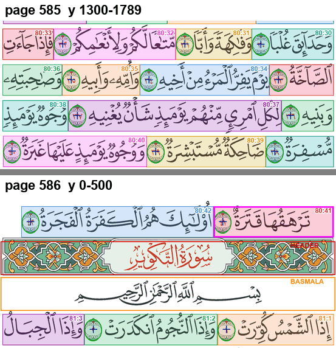

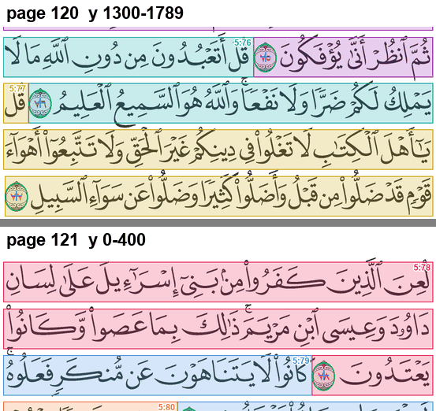

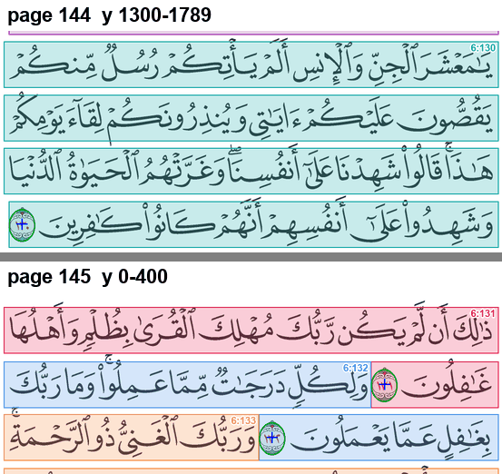

**تنبيه على معلومة سابقة:** ورد في ملاحظات الجلسات السابقة أن صفحات التطبيق تطابق ترقيم ذلك الموقع لكل الآيات. هذا غير صحيح بحسب الصور، وصحّحته في الذاكرة.

**القرار:** لا تعديل. أكّد صاحب المشروع (٢٠٢٦-١١-٠٥) أن الصور من أحدث طبعة لمصحف المدينة، وهي مقصودة. فالاختلاف متوقع مع الطبعات الأقدم التي يعتمدها الموقع.

**ما يجب الانتباه له مستقبلاً:** أي بيانات خارجية مرتبطة برقم الصفحة (توقيتات أو إحداثيات أو فهارس من مصادر أخرى) لا تُربط بالتطبيق برقم الصفحة في هذه الصفحات الـ٣٦، بل برقم السورة والآية.

---

## الملاحظة ٢: اللمس بين السطرين يختار آية بعيدة

**ما وجدته:** ارتفاع شريط التظليل ١٠٢ بكسل، والمسافة بين السطور نحو ١١٨، فيبقى بين كل سطرين شريط بارتفاع ١٦ بكسل (نحو ١٤٪ من ارتفاع السطر) لا تغطيه أي آية. وفيه تقع كثير من الحركات وذيول الحروف.

عند اللمس هناك تختار الدالة

`pickAyah`

في

`reader/MushafPage.kt`

الآية صاحبة **أقرب دائرة نهاية**، لا الآية التي تحت الإصبع. أخذتُ ١٥٤٥٩٥ نقطة حبر داخل هذه الأشرطة في الصفحات ٣–٦٠٤، فوجدت أن ٦٦٩٣٠ منها (٤٣٪) تختار آية ليست آية السطر الذي فوق النقطة ولا التي تحتها. والضغط المطوّل يستعمل الدالة نفسها، فتفتح قائمة الآية الجديدة على آية غير المقصودة.

مثال في الصفحة ٣: لمسة بين السطرين ٢ و٣ عند الموضع الأفقي ٧٨٤ تقع بين جزأين من البقرة ٧، فتختار البقرة ٦ لأن دائرتها أقرب.

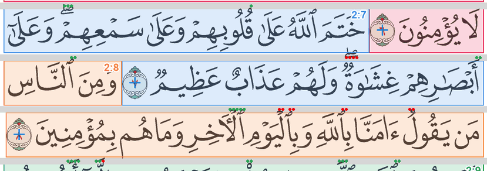

**المقترح:** إصلاح في الكود لا في البيانات. حين لا تقع اللمسة داخل أي مستطيل، تُختار الآية صاحبة **أقرب مستطيل** إلى نقطة اللمس، لا أقرب دائرة. هذا يُرجع الاختيار دائماً إلى آية السطر الذي فوق اللمسة أو تحتها، ولا يغيّر شكل التظليل.

الدالة

`screenBounds`

سليمة: تحسب الإطار الخارجي لمستطيلات الآية، ولأن المستطيلات صحيحة فموضع القائمة صحيح.

---

## الملاحظة ٣: تظليل فوق ورق فارغ في الأسطر المتوسَّطة

**ما وجدته:** خواتيم بعض السور سطر قصير في منتصف الصفحة. يبدأ تظليل آيته من الحافة اليمنى للسطر الكامل لا من أول النص، فيغطي ورقاً فارغاً عرضه ٧٩–٢٨٣ بكسل. نهاية الآية (يسار) صحيحة؛ العيب في الطرف الأيمن فقط.

| الصفحة | الآية | العرض الفارغ يمين النص |
|---:|---|---:|
| 255 | 13:43 | 126 |
| 528 | 53:62 | 270 |
| 534 | 55:78 | 154 |
| 545 | 58:22 | 151 |
| 586 | 80:41 | 79 |
| 593 | 88:25 | 107 |
| 594 | 89:29 | 168 |
| 600 | 101:10 | 159 |
| 602 | 106:4 | 233 |
| 602 | 107:6 | 96 |
| 602 | 108:3 | 265 |
| 603 | 110:3 | 196 |
| 603 | 111:5 | 216 |
| 604 | 112:4 | 256 |
| 604 | 113:5 | 267 |
| 604 | 114:5 | 187 |
| 604 | 114:6 | 283 |

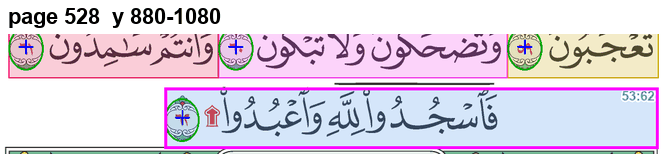

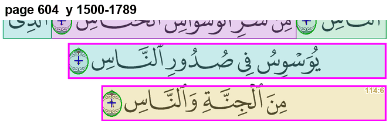

**ليست عيباً:** ٤٥ سطراً آخر يمتد فيها التظليل نحو ٥٠ بكسل يمين الحبر الأسود، وكلها بدايات أرباع أحزاب؛ ما هناك هو علامة الربع الحمراء، ودخولها في تظليل الآية صحيح.

**المقترح:** تعديل في السكربت

`build_ayah_regions.py`

وإعادة توليد البيانات: إذا كان السطر الذي تبدأ فيه الآية لا يصل حبره إلى الحافة، يبدأ التظليل من أول الحبر، كما يُفعل الآن في الصفحتين ١ و٢. أولوية منخفضة، وهو تعديل لملف البيانات فيحتاج موافقتك.

---

## مقارنة بالمراجعة السابقة

مراجعة ٢٠٢٦-٠٨-١٥ في

`docs/audits/ayah-boundaries-2026-08-15/`

وجدت ٦٢٠ نهاية خاطئة و٢٧ آية بلا سجل وأخطاء بدايات كثيرة. كل ذلك مُصلح في البيانات الحالية بحسب هذه المراجعة.

---

## الملفات

الصفحات الـ٣٦ والآيات المنقولة:

`page_boundary_differences.csv`

الأسطر الـ١٧ في الملاحظة ٣:

`centered_line_bands.csv`

كل ما سجّلته الفحوص الآلية، بما فيه بدايات الأرباع الـ٤٥:

`all_check_findings.csv`

الصور التوضيحية:

`img/`

سكربتات الفحص لإعادة التشغيل، وطريقة التشغيل في ملف داخلها:

`scripts/`
